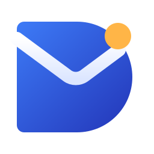
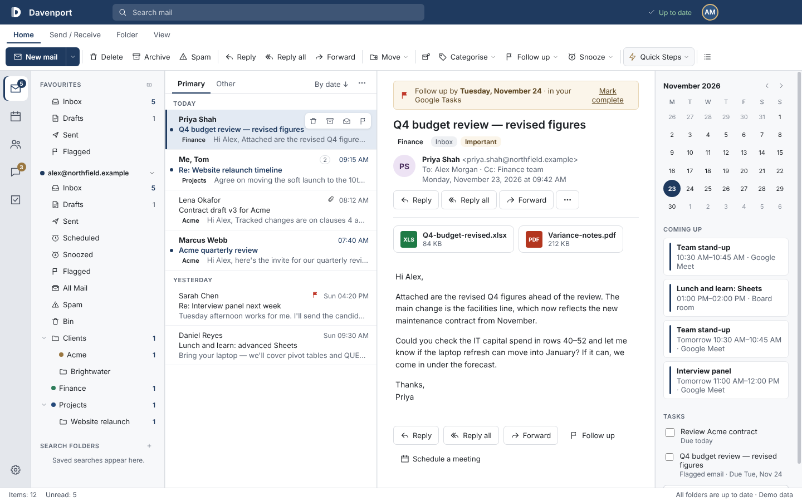

<p align="center"></p>

# Davenport

**An Outlook-style desktop client for Google Workspace.** Gmail, Google Calendar, Contacts, Google Chat and Google Tasks in one window, with the tools people rely on in Outlook: a folder pane, reading pane, ribbon, rules, Quick Steps, Search Folders, follow-up flags, a Scheduling Assistant and a To-Do bar.

Website: [davenport-app.com](https://davenport-app.com)



## Features

| Area | What you get |
| --- | --- |
| **Mail** | Folder tree from Gmail labels (nested), Favourites, unified inbox across accounts, Primary / Other inbox tabs, conversation view, reading pane right/bottom/off, drag-and-drop to folders, categories as coloured chips, rules (saved as real Gmail filters), Quick Steps, Search Folders, flag for follow-up (creates a Google Task), snooze, send later, undo send, signatures, templates, automatic replies (linked with Calendar out of office), high importance, large attachments as Drive links, print and save as PDF, offline reading and instant full-text search, remote images blocked until you allow them |
| **Calendar** | Day, Work week, Week, Month and Schedule views; drag to create and move events; Scheduling Assistant from Google free/busy with suggested times; Google Meet links; rooms; repeat; reminders; focus time, out of office and working location; accept/tentative/decline; colleagues' calendars; a second time zone; create an event from an email |
| **Invitations** | Meeting invitations from Google Calendar, Outlook and Microsoft 365 show as a card in the email with Accept, Tentative and Decline, clashes with your calendar, and a Join button; Outlook invitations are added to your Google Calendar and answered with a standard meeting response |
| **People** | Google Contacts with groups, the whole Workspace directory downloaded for offline browsing, address autocomplete from contacts, the directory and people you've emailed; create, edit, email a group |
| **Chat** | Google Chat spaces and direct messages grouped by account, threads, reactions, mentions, notifications, your Chat status (Automatic, Do not disturb, Away, status message, synced with Google), turn a chat into an email |
| **Tasks** | Google Tasks lists, My Day, tasks from flagged email that complete the flag when ticked off |
| **Desktop** | Windows notifications, taskbar unread badge, notification-area icon, Outlook keyboard shortcuts (or Gmail's), light/dark/system theme, three densities, simplified or classic ribbon, `mailto:` handler, multiple accounts |

## Download

Get the latest build from the [Releases](../../releases) page:

- `Davenport-Setup-<version>.exe` — installer for Windows 10/11 that picks x64 or Arm64 automatically
- `Davenport-<version>-x64-portable.exe` / `-arm64-portable.exe` — no installation needed

The builds are not yet code-signed, so Windows SmartScreen will warn the first time: choose **More info › Run anyway**.

Davenport keeps itself up to date: it checks this repository's releases and offers new versions, which install when you say so (Settings › About › **Check for updates**).

**Installing across an organisation?** Davenport installs silently (`Davenport-Setup-<version>.exe /S /allusers`), and network managers can switch off its own updates and deploy their own Google client. See [docs/DEPLOYMENT.md](docs/DEPLOYMENT.md).

## First run

1. Start Davenport and choose **Add a Google account**. Your browser opens Google's own sign-in page; sign in and click **Allow**. That's it.
2. To explore first, choose **Explore with sample data**: a demo account with sample mail, calendar, contacts, chat and tasks. Remove it any time in Settings › Accounts.

Davenport talks to Google directly from your computer. There is no Davenport server, and your mail, calendar and contacts are never sent to the developers or anyone else. See the [privacy policy](https://davenport-app.com/privacy.html).

> While Google is reviewing Davenport, its sign-in page may say **"Google hasn't verified this app"**. Choose **Advanced › Go to Davenport** to continue.

**Organisations** that would rather Davenport signed in as their own Google app (for example as an *Internal* app in their Workspace) can set one up in their own Google Cloud project: see [docs/GOOGLE-SETUP.md](docs/GOOGLE-SETUP.md).

## Keyboard shortcuts

| Action | Outlook keys (default) | Gmail keys (optional) |
| --- | --- | --- |
| Mail / Calendar / People / Chat / Tasks | Ctrl+1 … Ctrl+5 | |
| New item | Ctrl+N | c |
| Reply / Reply all / Forward | Ctrl+R / Ctrl+Shift+R / Ctrl+F | r / a / f |
| Delete / Archive | Delete / Backspace | # / e |
| Mark read / unread | Ctrl+Q / Ctrl+U | Shift+I / u |
| Flag | Insert | s |
| Move to folder | Ctrl+Shift+V | v |
| Search | Ctrl+E | / |
| Send / Receive | F9 | |
| Send message | Ctrl+Enter | |
| Previous / next week (calendar) | Alt+← / Alt+→ | |

## What Google doesn't allow (and what Davenport does instead)

- **Snooze and scheduled send** aren't available to apps through the Gmail API. Davenport provides both itself, so they need Davenport running (it can stay in the notification area). Snoozed mail is kept in a `Davenport/Snoozed` label so it's visible on other devices.
- **Gmail's own templates** can't be read by apps; Davenport has its own template library.
- **Google Chat** works for Google Workspace accounts (Google doesn't offer it to apps for personal Gmail). Calls open in Google Meet.
- **Interactive emails** (Gmail's AMP emails) only work in Gmail on the web; Davenport says so and offers to open them there. Forms in emails aren't filled in inside Davenport for safety; Google Forms get an **Open form** button instead.
- **New mail** is checked every 30–60 seconds (configurable). Instant push would need a cloud relay, which Davenport deliberately avoids.
- **Recall and read receipts** have no Gmail equivalent.

## Building from source

Requirements: Node.js 22 or later. See [docs/BUILDING.md](docs/BUILDING.md) for the details, including how release builds get Davenport's Google sign-in.

```bash
npm install
npm run dev          # run with hot reload
npm test             # unit tests (sync engine, MIME, search, rules, invitations)
npm run e2e          # interface checks against the demo account (needs a display; xvfb-run on Linux)
npm run typecheck
npm run dist:win     # Windows installer + portable builds (x64 and arm64) into release/
npm run dist:mac     # macOS universal .dmg (run on a Mac)
npm run dist:linux   # AppImage and .deb
```

Building Windows installers on Linux or macOS needs [Wine](https://www.winehq.org/) (64- and 32-bit). The included GitHub Actions workflow tests every push and pull request, builds Windows (and, when switched on, macOS and Linux) on native runners, and drafts a release with the installers whenever you push a tag like `v1.1.0`.

A build from source without Davenport's Google client asks each user to connect their own Google Cloud project (as above); everything else works the same.

`node scripts/screenshots.mjs` launches the app with the demo account and captures every screen (useful for checking UI changes).

## How it's built

- **Electron + TypeScript + React.** The window never talks to Google directly; a background engine (Electron's main process) owns accounts, the local cache and every API call. The two halves talk over a typed contract in `app/shared/api.ts`.
- **Local cache:** SQLite built into Electron (`node:sqlite`) with FTS5 full-text search — no native modules, so x64 and Arm64 builds are identical.
- **Sync:** Gmail history IDs for incremental mail sync; an offline queue replays your changes in order when you reconnect.
- **Security:** OAuth 2.0 with PKCE through the system browser; refresh tokens encrypted by the operating system (DPAPI on Windows); email rendered in a sandboxed frame with scripts disabled and remote content blocked by default.

```
app/main        background engine: accounts, sync, outbox, rules, cache, notifications
app/main/google Google API clients (Gmail, Calendar, People, Tasks, Chat, Drive) and MIME
app/preload     the narrow bridge the window is allowed to use
app/renderer    the interface (React)
app/shared      types and the API contract shared by both halves
tests           unit tests, including the sync engine against a simulated Gmail
scripts         build helpers and the screenshot harness
```

## Contributing

Bug reports, ideas and pull requests are welcome: see [CONTRIBUTING.md](CONTRIBUTING.md). To report a security problem privately, see [SECURITY.md](SECURITY.md).

## Licence

MIT — see [LICENSE](LICENSE). Davenport is an independent project and is not affiliated with Google or Microsoft. Gmail, Google Workspace and Google Chat are trademarks of Google LLC; Outlook is a trademark of Microsoft Corporation.
